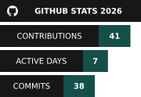

<picture>
  <source media="(prefers-color-scheme: dark)" srcset="assets/logo-dark.svg" />
  <source media="(prefers-color-scheme: light)" srcset="assets/logo-light.svg" />
  
</picture>

 

  
  
  
  

I'm a second-year BEng Computer Science student at Anglia Ruskin University in Cambridge, UK. This trimester, I'm building a C# web app with a team for <strong>Software Engineering</strong>, as part of a live industry brief. It's designed to help engineers search medical-device recall notices and turn their findings into reports. For <strong>Database Design and Implementation</strong>, I'm designing a database for a hospital management system as part of a live client brief, covering ER modelling, implementation, security, and auditing.

Outside university, I've built and run <strong>Atlas</strong>, a home server made from salvaged PC parts, and I'm developing <strong><a href="https://github.com/george-cliff/murmur">Murmur</a></strong> (the repo will be public soon), where I'm exploring offline bird-call detection using embedded systems and machine learning. I'm also making a start on <strong><a href="https://github.com/george-cliff/triarch">Triarch</a></strong>, where I'm building a Python benchmark harness to compare the same programs written in C, C++, and Rust, to understand how each performs and the trade-offs between them.

I'm starting to document what I'm working on and what I learn along the way on <strong><a href="https://georgecliff.com/">my website</a></strong>, with a mix of devlogs following my projects, shorter notes on things I've learnt about, the occasional article, and the odd post about my hobbies. I'm still getting into the habit of writing, so posts may be a bit sporadic for now.

At the moment, I'm learning more about computer architecture and systems programming, starting with RISC-V. I'm also practising C and learning C++, Rust, and SystemVerilog, as well as machine learning with PyTorch for Murmur, and relational databases with MySQL at university.

I'm interested in collaborating on <strong>open-source projects</strong>, particularly those involving systems programming and embedded computing. I'd also welcome advice or mentorship in <strong>systems programming and computer architecture</strong>, and I'm always happy to chat about <strong>getting started with Linux</strong>, <strong>building a home server</strong>, or what I'm learning while trying to <strong>teach a tiny computer to recognise birdsong</strong>.

<picture>
  <source media="(prefers-color-scheme: dark)" srcset="assets/signature-dark.svg" />
  <source media="(prefers-color-scheme: light)" srcset="assets/signature-light.svg" />
  
</picture>
