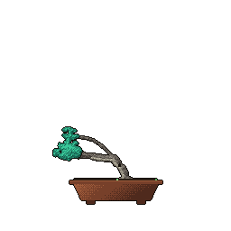

# Hi, I'm George 🐦‍⬛

I'm a **second-year BEng Computer Science student** at Anglia Ruskin University in Cambridge, UK. I enjoy figuring out what makes things work, building projects to understand computers better, and seeing how far limited hardware can be pushed.

### A few projects I'm working on

- **[Triarch](https://github.com/george-cliff/triarch-compute-sim):** A RISC-V processor project currently in the **design phase**, exploring software emulation in C, C++, and Rust alongside a SystemVerilog hardware model. A Python harness will benchmark, test, and verify the emulators to explore performance and language trade-offs.

- **[Murmur](https://github.com/george-cliff/murmur):** A bird-audio detection project using Python, PyTorch, Rust, and ONNX. Currently a desktop proof of concept combining a lightweight bird-activity classifier with species identification, with the longer-term goal of building independent, low-power wildlife-monitoring devices.

- **[Atlas](https://github.com/george-cliff/atlas-homelab):** A Debian home server built from salvaged PC parts, running self-hosted services in Docker containers with remote access through Tailscale and encrypted off-site backups.

I'm looking for a **year-long engineering placement for the 2027/28 academic year**, particularly in computer architecture, systems programming, or embedded software. I'm also keen to contribute to **open-source projects**, so I can put what I've been learning into practice and continue learning alongside experienced developers.

[**My CV**](https://georgecliff.com/files/george-cliff-cv.pdf) covers my experience so far, and I'm starting project write-ups on [**my website**](https://georgecliff.com/).

Feel free to connect with me on [**LinkedIn**](https://linkedin.com/in/georgecliff) or [**send me an email**](mailto:gcliff@fastmail.com). I'm always happy to chat!

<picture>
  <source media="(prefers-color-scheme: dark)" srcset="assets/signature-dark.svg" />
  <source media="(prefers-color-scheme: light)" srcset="assets/signature-light.svg" />
  
</picture>
